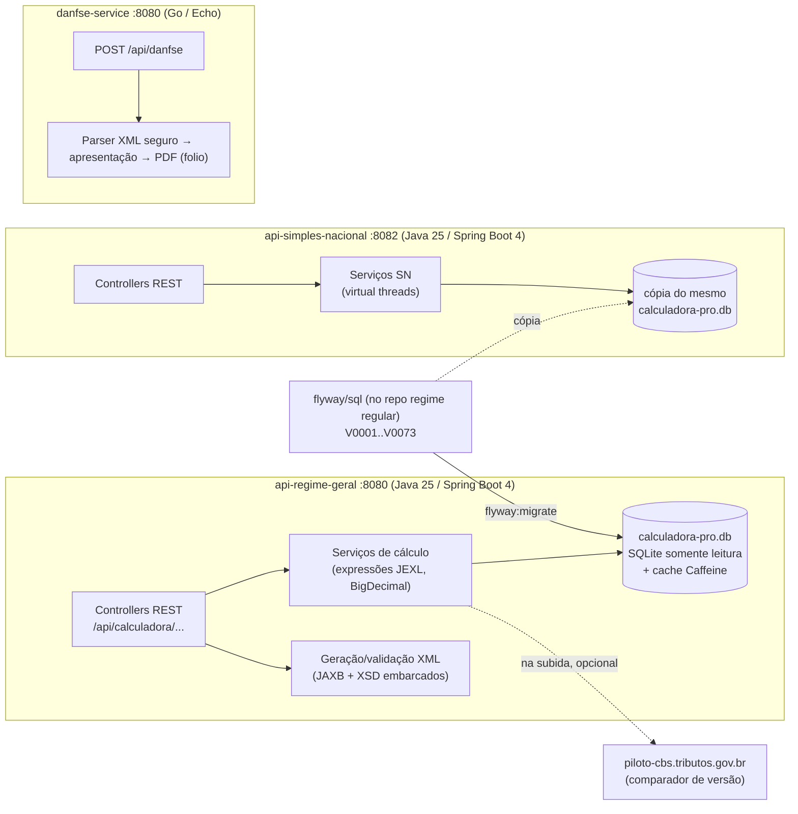

# Tributo360 · Fase 0: descoberta técnica dos motores da Receita Federal

Data da análise: 24/11/2026. Todos os fatos abaixo foram conferidos no código e executados localmente
(Linux, Java 25, Go 1.27). Onde algo é inferência ou dúvida, está marcado como tal.

| Repositório | Versão analisada (tag / commit) | Linguagem | Licença |
|---|---|---|---|
| [calculadora-rtc-regime-regular](https://github.com/ReceitaFederal/calculadora-rtc-regime-regular) | 1.7.2 / `f1eebd7` (19/11/2026) | Java 25 + Spring Boot 4.1.2 | MIT |
| [calculadora-rtc-simples-nacional](https://github.com/ReceitaFederal/calculadora-rtc-simples-nacional) | 1.0.2 / `a926d5a` (19/11/2026) | Java 25 + Spring Boot 4.1.2 | MIT |
| [calculadora-rtc-gerador-danfse](https://github.com/ReceitaFederal/calculadora-rtc-gerador-danfse) | 1.0.0 / `8d79e6b` (22/10/2026) | Go 1.27 + Echo v5 | MIT |

**Conclusão curta:** dá para construir o Tributo360 sobre os três motores. Os três sobem como
serviços HTTP independentes, sem autenticação, com OpenAPI, e os testes oficiais passam. Mas os motores
são **calculadoras por operação**: não importam XML de nota, não apuram período, não calculam a
alíquota efetiva do Simples e, a partir de 2027, exigem que as alíquotas nominais de IBS/CBS sejam
informadas pelo chamador. Essas lacunas são exatamente onde o SaaS precisa agregar valor (e onde há
risco tributário).

---

## 1. Resumo de cada README

### 1.1 Regime regular (`api-regime-geral`)
API REST que calcula CBS, IBS e Imposto Seletivo (LC 214/2025) nas operações do regime regular, expõe
as tabelas oficiais usadas no cálculo ("dados abertos": CST, cClassTrib, NCM, NBS, fundamentações,
alíquotas de referência) e gera/valida os grupos de tributação XML dos DF-e. Banco SQLite embarcado,
somente leitura, gerado por migrations Flyway que vêm no próprio repositório. Porta 8080, contexto
`/api`. Público declarado: empresas de tecnologia, desenvolvedores e contribuintes.

### 1.2 Simples Nacional (`api-simples-nacional`)
API REST que calcula CBS e IBS de contribuintes do Simples Nacional. Porta 8082. **Não tem banco
próprio**: o README manda copiar a pasta `flyway/` do repositório do regime regular e gerar o mesmo
`calculadora-pro.db`. Observação: o `docs/exemplos.md` deste repositório é uma cópia literal do exemplo
do regime regular (porta 8080, endpoint `regime-geral`) e não documenta o Simples; a referência real é
o Swagger.

### 1.3 Gerador DANFSe (`danfse-service`)
Serviço HTTP em Go que recebe o **XML de uma NFS-e já autorizada (padrão nacional)** e devolve o
**PDF do DANFSe** (representação gráfica). Confirmado: é DANFS**e** (serviço), não DANFE de NF-e, e a
linguagem é Go, como o briefing antecipava. Também compila para WebAssembly (roda no navegador).
Não calcula tributo e não emite nota.

---

## 2. Instruções reproduzíveis de execução (testadas)

Pré-requisitos: Java 25 (JDK), Go ≥ 1.27, Maven 3.9+ (ou o `mvnw` do repositório), Git.

```bash
# --- Regime regular -------------------------------------------------------
git clone --branch 1.7.2 https://github.com/ReceitaFederal/calculadora-rtc-regime-regular.git
cd calculadora-rtc-regime-regular
mkdir -p calculadora/db
./mvnw flyway:migrate -Dflyway.configFiles=./flyway/flyway-pro.conf --batch-mode --errors   # ~10 s, gera 5,5 MB
./mvnw clean test                       # 1.314 testes, 0 falhas, 10 ignorados (~1 min 15 s)
./mvnw clean package -DskipTests
java -Dspring.profiles.active=offline -jar target/api-regime-geral.jar   # sobe em ~12 s
# Swagger: http://localhost:8080/api/swagger-ui.html   OpenAPI: /api/api-docs

# --- Simples Nacional -----------------------------------------------------
git clone --branch 1.0.2 https://github.com/ReceitaFederal/calculadora-rtc-simples-nacional.git
cd calculadora-rtc-simples-nacional
mkdir -p calculadora/db
cp ../calculadora-rtc-regime-regular/calculadora/db/calculadora-pro.db calculadora/db/   # mesmo banco
./mvnw clean package                    # 376 testes, 0 falhas (~27 s)
java -Dspring.profiles.active=offline -jar target/api-simples-nacional.jar
# Swagger: http://localhost:8082/api/swagger-ui.html   Métricas: :9103/metrics

# --- DANFSe ---------------------------------------------------------------
git clone --branch 1.0.0 https://github.com/ReceitaFederal/calculadora-rtc-gerador-danfse.git
cd calculadora-rtc-gerador-danfse
go test -race -count=1 ./...            # todos os pacotes ok, cobertura 80,4%
SERVER_PORT=8090 go run ./cmd/danfse    # ou: docker build -t danfse-go . (Dockerfile oficial)
# Swagger: http://localhost:8090/api/swagger-ui/index.html
```

Pontos práticos observados:

- Os JARs são executados **a partir da raiz do projeto**, porque o caminho do banco é relativo
  (`./calculadora/db/calculadora-pro.db`, aberto com `mode=ro`).
- No perfil `offline`, o regime regular consulta na subida
  `https://piloto-cbs.tributos.gov.br/.../dados-abertos/versao` para comparar versões (3 tentativas,
  timeout 5 s/10 s). Se não houver rede, só gera aviso no log. A URL é configurável por
  `VERSAO_OFFLINE_URL`; em produção convém apontar para nada ou aceitar a chamada conscientemente.
- Regime regular e Simples **não têm Dockerfile** no repositório (o roadmap fala em "JAR e Docker", mas
  o Dockerfile não está publicado). O Tributo360 precisa escrever os seus.
- O changelog do Simples (1.0.1) recomenda subir a JVM com `-XX:-UseBASE64Intrinsics` por causa do
  aviso de segurança do OpenJDK de 17/11/2026. Vale aplicar aos dois JARs.
- Consumo medido em repouso após aquecimento: ~690 MB RSS (regime regular), ~515 MB (Simples),
  ~34 MB (DANFSe). Latência do cálculo de 4 itens com observabilidade: p50 22 ms, máx 31 ms (30 chamadas).

---

## 3. Arquitetura real



Características comuns aos dois motores Java (confirmadas no código e nos ADRs):

- **Sem estado e sem autenticação**: `WebSecurityConfig` libera todas as rotas (`permitAll`), CSRF
  desligado, CORS habilitado. Precisam rodar em rede interna, nunca expostos.
- **Banco embarcado somente leitura** com as tabelas tributárias (cClassTrib, CST, NCM, NBS,
  alíquotas, fundamentações, atividades do Simples). Atualização = nova versão do repositório com
  novas migrations Flyway (ex.: `V0073` = tabela cClassTrib IT 2025.002 v1.71 de 30/10/2026).
- Cálculo determinístico parametrizado por expressões no banco (ADR001), precisão `BigDecimal`
  com política de arredondamento única compartilhada entre os dois projetos (ADR003).
- Observabilidade: Actuator, Prometheus, OpenTelemetry (OTLP opcional).
- Resposta de cálculo traz `memoriaCalculo` em texto e headers de versão.

---

## 4. Inventário de endpoints, entradas e saídas

Lista completa extraída do OpenAPI de cada serviço em execução. Todos os caminhos com prefixo `/api`.

### 4.1 Regime regular (53 operações)

| Grupo | Endpoint | Entrada → Saída |
|---|---|---|
| **Cálculo** | `POST /calculadora/regime-geral` | Operação (JSON: `dhFatoGerador`, `uf`, `municipio`, itens com `ncm`/`nbs`, `cst`, `cClassTrib`, `baseCalculo`, `quantidade`, IS, `aliquotasNominais`) → grupos `IBSCBS`/`IS` por item + totais. Falha a operação inteira (HTTP 422) no primeiro erro. |
| | `POST /calculadora/observabilidade/regime-geral` | Mesma entrada → por item `estadoItem` (`CALCULADO`, `CALCULO_SIMULADO`, `INCONSISTENCIA_ENTRADA`, `NAO_IMPLEMENTADO`, `FALHA_TECNICA`) + erros RFC 7807 com `pointer`; HTTP 200 mesmo com itens em erro. **É o endpoint certo para o SaaS.** |
| | `GET /calculadora/observabilidade/erros?codigo=REG-xxx` | Descrição de um código de erro. |
| | `POST /calculadora/pedagio` | Rateio por trecho de pedágio. |
| **Bases** | `POST /calculadora/base-calculo/base-calculo-unificada` (NF-e/NFC-e), `.../base-calculo-unificada-nfse`, `.../is-mercadorias`, `.../cbs-ibs-mercadorias` | Componentes do documento (`vProd`, `vFrete`, `vICMS`...) → `baseRG`, `baseIS`, `baseSN` + avisos de vigência. |
| **NFS-e** | `POST /calculadora/nfse/base-calculo`, `POST .../indicador-operacao/validate`, `GET .../local-operacao`, `.../indicador-operacao`, `.../locais-fornecimento`, `.../locais-incidencia`, `.../situacoes-classificacoes-tributarias` | Regras de local de incidência e indicador de operação da NFS-e. |
| **XML** | `POST /calculadora/xml/generate?tipo=` | **Resposta do `/regime-geral`** → XML do grupo de tributação (`<det><imposto><IBSCBS>...`). Tipos: nfe, nfce, cte, cte-simplificado, bpe, bpe-tm, nf3e. |
| | `POST /calculadora/xml/validate?tipo=&subtipo=grupo\|nota` | XML → `true` ou HTTP 422 com linha/coluna. Valida contra XSD; aceita também `nfse`. Versões: NF-e/NFC-e NT v1.36; CT-e/BP-e/NF3e v1.14a; NFS-e v1.01.03 NT004. |
| **Dados abertos** (31 GETs) | `/calculadora/dados-abertos/...`: `ufs`, `ufs/municipios`, `situacoes-tributarias/cbs-ibs\|is`, `classificacoes-tributarias/...` (por CST, por cClassTrib, por atores, NCM/NBS aplicáveis), `ncm`, `ncm/vigentes`, `nbs`, `nbs/lista`, `fundamentacoes-legais`, `aliquota-uniao\|uf\|municipio`, `redutores-compra-governamental`, `transferencias-cbs\|ibs`, `nomenclatura/{dfe}/{cClassTrib}`, `dfe/grupos`, `ator/grupos`, `versao` | Consultas por data de vigência. Base para os cadastros e combos do SaaS. |
| Operacional | `GET /versao/status`, `GET /calculadora/download/url` | Comparação com a instalação online; URL de download (sem plataformas configuradas no offline). |

Chamadas reais feitas (todas reproduziram o documentado):

- Exemplo oficial de 4 itens em 2027 → itens 1–3 `CALCULO_SIMULADO`, item 4 `INCONSISTENCIA_ENTRADA`
  (REG-011, NCM não vinculada), totais vCBS 56,76 / vIBS 0,64 / vIS 15,00, header
  `x-warning-dados-simulados`. O mesmo payload no `/regime-geral` retorna 422.
- Operação de 2026 sem alíquotas informadas → `CALCULADO` com alíquotas de teste de 2026 (CBS 0,90%,
  IBS UF 0,10%), memória de cálculo citando o art. 129.
- `xml/generate?tipo=nfe` sobre esse resultado → XML válido; `xml/validate` → `true`.

### 4.2 Simples Nacional (7 operações)

| Endpoint | Entrada → Saída |
|---|---|
| `POST /calculadora/observabilidade/simples-nacional/nao-assistido` | Operação com `data`, `tpDoc` (55, 65, 57, 67, 63, 93, 62 ou 91 NFS-e), regime no vocabulário do documento (`CRT`/`tpRegimeIBSCBS` ou `opSimpNac`/`regApIBSCBSSN`/`regApTribSN`), **`aliquotasEfetivas` informadas pelo chamador** (par pCBSSN/pIBSSN por anexo, `fatorR`, `impedimentoSublimite`) e itens (`cAtivSN`, `cClassTrib`, NCM/NBS, `baseCalculo`, vIS) → `regimeApuracao`, `resolucaoAliquotas` (anexo aplicado, com/sem redistribuição do ISS, motivo), por item vCBSSN/vIBSSN e memória, totais. |
| `POST /calculadora/observabilidade/simples-nacional` | **Marcado como OBSOLETO** no próprio OpenAPI (alíquotas por item, só NF-e/NFC-e). Não usar. |
| `GET .../simples-nacional/erros?codigo=VSN-xxx` | Catálogo de erros. |
| `GET /calculadora/simples-nacional/atividades?data=` e `/{codigo}` | 15 atividades (`cAtivSN`) com anexo, sujeição ao fator r e tpDoc admissíveis. |
| `GET /versao`, `GET /versao/status` | Versão do app e do banco. |

Chamadas reais: exemplo NF-e CRT 1 → `CALCULADO`, CBS 11,61 + IBS 0,13 sobre R$ 1.000. O exemplo de
**NFS-e do próprio Swagger falhou** com VSN-050 ("NBS 114051000 não encontrada para 2027-03-15") contra o
banco V0073, ou seja, o exemplo oficial está desatualizado em relação às tabelas.

O comentário no controller diz que "o cálculo assistido, quando disponível, tem controlador próprio";
o changelog 1.0.0 menciona "três endpoints de cálculo" e "GET de alíquotas" do PGDAS, mas **esses
endpoints não existem no código publicado**. O roadmap coloca a integração PGDAS-D / Receita Integra
(com autenticação) na Release 16.

### 4.3 DANFSe (3 operações)

| Endpoint | Entrada → Saída |
|---|---|
| `POST /api/danfse?stc=0\|1\|2&canhoto=true\|false` | Corpo `application/xml` com `<NFSe versao="1.00">` (padrão nacional), até 5 MiB (configurável até 32 MiB) → `application/pdf`. `stc`: válida, substituída, cancelada. Erro → 400 JSON `{"sucesso":false,"mensagem":...}`. |
| `GET /health/live`, `GET /health/ready` | Probes. |

Chamada real: XML de teste do repositório → HTTP 200, PDF 1.7 de 1 página (78 KB). Proteções: rejeita
DOCTYPE/ENTITY (XXE), não loga conteúdo fiscal. README avisa que hoje erros internos também saem como 400.

---

## 5. Matriz de funcionalidades

| Necessidade do briefing | Suportado pelos motores? | Observação |
|---|---|---|
| Calcular CBS/IBS/IS de uma operação do regime regular | **Sim** | `observabilidade/regime-geral`, com memória de cálculo e erro por item. |
| Calcular CBS/IBS no Simples Nacional | **Sim, parcial** | Só com alíquotas efetivas informadas pelo usuário. |
| Calcular alíquota efetiva do Simples (RBT12, faixas) | **Não** | Explicitamente fora do escopo (é do PGDAS-D). |
| Alíquotas nominais de IBS/CBS a partir de 2027 | **Não** | Cadastradas só para 2026; de 2027 em diante o chamador informa `aliquotasNominais` e o resultado vem como `CALCULO_SIMULADO`. |
| Tabelas oficiais (cClassTrib, CST, NCM, NBS, fundamentação) | **Sim** | Dados abertos, por vigência. |
| Validar se NCM/NBS combina com cClassTrib | **Sim** | Erros REG-0xx / VSN-0xx. |
| Sugerir classificação de produto | **Não** | Só valida a combinação informada. |
| Importar XML de NF-e/NFS-e e recalcular | **Não** | Nenhum endpoint lê nota e extrai itens. O SaaS precisa fazer o parser e montar a entrada. |
| Validar XML de nota contra XSD | **Sim** | `xml/validate?subtipo=nota` (NF-e, NFC-e, NFS-e, CT-e, BP-e, NF3e). Só estrutura, não confere valores. |
| Conferir se o imposto destacado na nota está correto | **Não diretamente** | Possível compondo: parser próprio → cálculo → comparação feita pelo SaaS. |
| Gerar grupo XML de tributação | **Sim** | `xml/generate`. |
| Emitir/transmitir NF-e/NFS-e | **Não** | Fora do escopo (e do briefing). |
| Gerar PDF do DANFSe | **Sim** | A partir de NFS-e nacional autorizada. |
| Gerar DANFE (NF-e) | **Não** | |
| Apuração por período, créditos acumulados, escrituração | **Não** | O roadmap diz que não faz apuração assistida. |
| Cashback, ZFM, monofásico de combustíveis, parte do IS | **Não / incompleto** | Previstos para Release 16 e 2027. |
| Versão do motor e do banco para rastreabilidade | **Sim** | `GET .../versao` e headers de resposta. |
| Autenticação, multiempresa, histórico, relatórios | **Não** | É o produto Tributo360. |

---

## 6. Licenças e dependências

- **Os três repositórios são MIT** (Copyright 2026 Receita Federal do Brasil). Uso comercial, modificação
  e redistribuição são permitidos; a obrigação é **manter o aviso de copyright e a licença** em cópias
  e partes substanciais. Não há garantia. Rodar os motores como serviços internos do SaaS é compatível.
- Dependências Java (150 pacotes, levantadas com `license-maven-plugin`): Apache 2.0 na grande maioria,
  além de MIT, BSD, EDL/EPL 2.0. Os únicos itens com GPL/LGPL são **duplamente licenciados** (Logback
  EPL-2.0/LGPL-2.1; Jakarta Annotations/Transaction EPL-2.0/GPL2 com Classpath Exception), sem impedimento
  para uso como serviço. Lombok (MIT) é só de compilação.
- Dependências Go: Apache 2.0 e MIT. A biblioteca de PDF `github.com/carlos7ags/folio` é Apache 2.0 e
  **tem arquivo NOTICE**, que deve ser preservado se a imagem for redistribuída.
- O nome e a marca da Receita/SERPRO não vêm com a licença MIT. Não usar no posicionamento comercial
  como endosso (alinha com a seção 10 do briefing).
- **Recomendação:** manter `THIRD_PARTY_NOTICES` no Tributo360 com as licenças dos motores e da folio,
  e uma página "Componentes de código aberto" no produto. Validar com jurídico antes do lançamento.

---

## 7. Proposta de integração com Django

A estrutura combinada se confirma com dois ajustes (Dockerfiles próprios e banco compartilhado):

```
tributo360/
├── app/                       # Django + DRF (o produto)
│   └── engines/               # app Django: clientes HTTP dos motores
│       ├── clients/regime_regular.py
│       ├── clients/simples.py
│       ├── clients/danfse.py
│       ├── schemas/           # contratos internos (pydantic/dataclasses), versionados
│       └── tests/             # testes de contrato contra os motores reais
├── engines/                   # submódulos git presos em tags oficiais
│   ├── calculadora-rtc-regime-regular   @ 1.7.2
│   ├── calculadora-rtc-simples-nacional @ 1.0.2
│   └── calculadora-rtc-gerador-danfse   @ 1.0.0
├── docker/
│   ├── engine-db.Dockerfile   # roda flyway uma vez → calculadora-pro.db
│   ├── regime-regular.Dockerfile
│   └── simples.Dockerfile     # (DANFSe usa o Dockerfile oficial)
├── docker-compose.yml
└── THIRD_PARTY_NOTICES.md
```

Fluxo e regras:

1. **Build**: um estágio gera o `calculadora-pro.db` a partir de `engines/calculadora-rtc-regime-regular/flyway`
   e o copia para as duas imagens Java. Assim os dois motores usam exatamente a mesma versão de tabela.
2. **Rede**: os três motores ficam só na rede interna do compose (sem `ports:` publicados). Só o Django
   fala com eles. Eles não têm autenticação.
3. **Adaptadores** no Django: um cliente por motor com timeout (ex.: 5 s), retry só para erro de rede,
   tradução de `estadoItem` e erros RFC 7807 para mensagens do produto. O SaaS usa sempre os endpoints
   de **observabilidade** (erro por item) e nunca o obsoleto do Simples.
4. **Rastreabilidade**: cada `Simulacao` guarda o payload enviado, a resposta integral (JSONB),
   `versaoApp`, `versaoDb` e `dataVersaoDb` lidos de `/versao`, e se o resultado foi `CALCULADO` ou
   `CALCULO_SIMULADO`. Isso atende a seção 9 do briefing sem reimplementar regra.
5. **Simulado vs. oficial**: a partir de 2027, o produto tem que pedir (ou ter cadastradas, com fonte)
   as alíquotas nominais por UF/município e as alíquotas efetivas do Simples do cliente. A UI deve
   deixar claro quando o resultado é simulado.
6. **Documentos**: o "importar XML" é código nosso em Python (lxml): validar com `xml/validate`,
   extrair itens, chamar o cálculo e comparar com o destacado na nota. Começar só por NF-e 55 e NFS-e
   nacional. Processamento em lote via Celery, porque cada nota vira N chamadas.
7. **Tabelas no Django**: espelhar só o necessário (cClassTrib, CST, NCM/NBS) a partir dos endpoints de
   dados abertos, para alimentar formulários e o cadastro de produtos, com a versão do banco gravada.
8. **Atualização**: bump da tag do submódulo → CI sobe os motores e roda a suíte de contrato do
   Tributo360 (casos dourados) → só então deploy. O painel de versões do briefing lê `/versao`.

Alternativa considerada e descartada por ora: em vez de submódulos, `git clone --branch <tag>` dentro
dos Dockerfiles. É mais simples, mas some do repositório a referência exata do código usado. Os
submódulos também deixam o código à mão para consulta (o que você queria).

Recursos: ~1,3 GB de RAM só para os dois motores Java em repouso. Uma VPS de 4 GB fica justa para
Django + Postgres + Redis + motores; 8 GB é mais confortável.

---

## 8. Riscos e perguntas em aberto

**Riscos**

1. **Resultado simulado a partir de 2027.** O motor não tem alíquotas nominais além de 2026; o valor
   final depende do que o escritório informar. Risco de o cliente tratar simulação como apuração.
2. **Simples depende de dado que não temos.** Sem PGDAS-D/Receita Integra (prevista para Release 16,
   com autenticação), o contador precisa digitar as alíquotas efetivas por anexo. A integração futura
   pode exigir credenciais do contribuinte, o que puxa o tema de certificados (seção 6 do briefing).
3. **Ritmo de mudança alto.** Regime regular saiu da 1.4.0 à 1.7.2 em ~3 meses, com mudança de
   arredondamento em centavos na 1.7.2. Sem testes de contrato próprios, uma atualização pode alterar
   resultados históricos silenciosamente.
4. **Repositório é espelho.** Não aceita PR externo (só issues/discussions) e publica releases em bloco;
   correções dependem da RFB/SERPRO.
5. **Documentação inconsistente**: exemplos do Simples copiados do regime regular; exemplo NFS-e do
   Swagger do Simples falha com o banco atual; endpoints "assistido" citados mas inexistentes.
6. **Motores sem autenticação** e com chamada de saída para o piloto da Receita na subida; exigem
   isolamento de rede.
7. **Conferência de nota é construção nossa.** O parser de XML e a regra de comparação ficam no
   Tributo360, e é aí que mora o maior risco de erro tributário. Precisa de revisão especializada.

**Perguntas para você decidir**

1. Para o MVP, a conferência de documentos começa só por **NF-e (55) e NFS-e nacional**? (Recomendo sim.)
2. Para 2027+, o produto mantém uma **tabela de alíquotas nominais** por UF/município (com fonte e data)
   ou o contador digita em cada simulação? A primeira opção é mais útil e mais responsabilidade.
3. No Simples, aceitamos que o contador informe as **alíquotas efetivas do PGDAS-D** manualmente
   por período até existir a integração oficial?
4. O DANFSe entra no MVP? Ele só serve para quem já tem o XML autorizado da NFS-e; é barato de
   integrar, mas não resolve dor central do contador.
5. Onde vai hospedar (VPS própria, cloud gerenciada)? Isso define o desenho do compose/deploy.
6. Quer que eu abra issues nos repositórios da Receita sobre as inconsistências de documentação?
   (É público e fica no seu nome; só faço se você pedir.)

---

## Próximo passo sugerido

Etapa 4 do briefing: modelo de dados multi-tenant, permissões e contratos Django ↔ motores, seguido
do backlog priorizado. Nada de código do produto até você validar este relatório.
