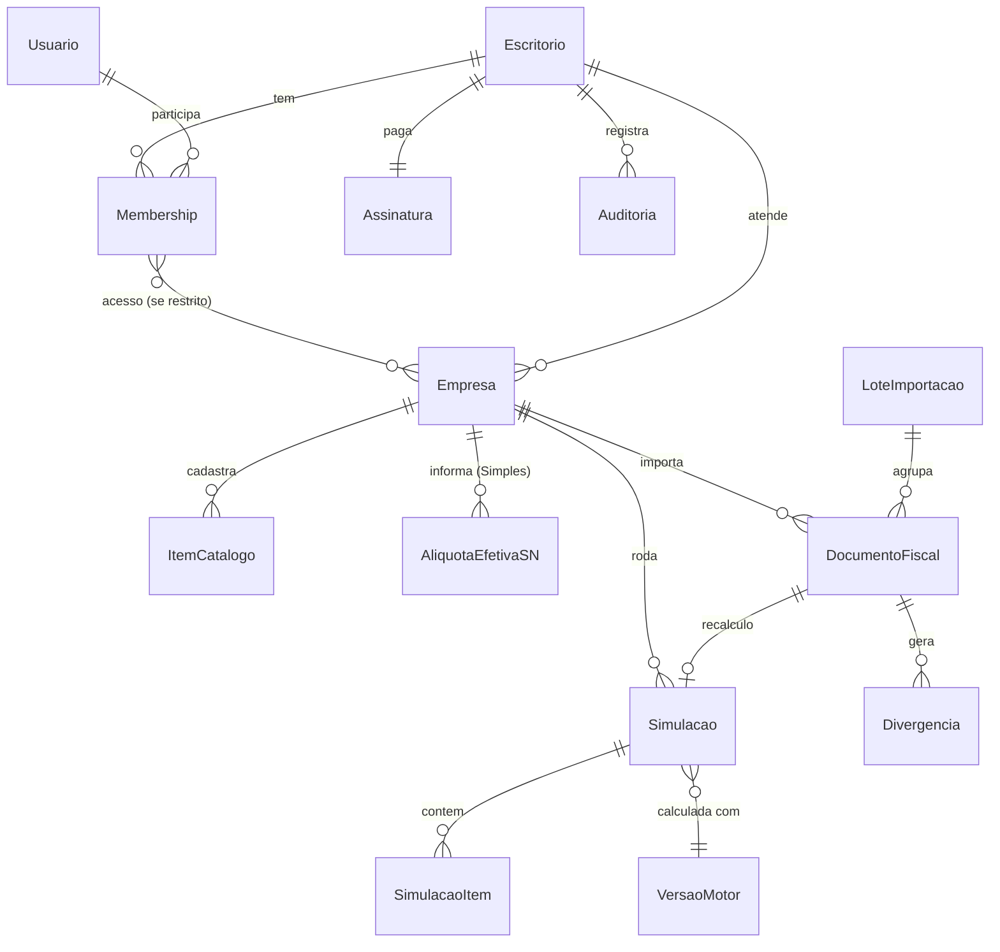

# Tributo360 · Etapa 4: decisões, modelo de dados, contratos, hospedagem e backlog

Data: 24/11/2026. Baseado em `docs/descoberta.md` e nas respostas do guilherme às perguntas da Fase 0.

## 1. Decisões registradas

| # | Pergunta | Decisão |
|---|---|---|
| D1 | Escopo da conferência de documentos no MVP | Só **NF-e (modelo 55)** e **NFS-e nacional**. |
| D2 | Alíquotas nominais de IBS/CBS para 2027+ | **As duas formas**: o produto mantém uma tabela de alíquotas por UF/município (com fonte e data), usada como padrão, e o contador pode **editar o valor na simulação**. Toda edição fica registrada. |
| D3 | Alíquotas efetivas do Simples | O contador **informa manualmente** as alíquotas do PGDAS-D por empresa e período, até existir a integração oficial. |
| D4 | DANFSe | Entra no MVP como **funcionalidade simples**: enviar o XML de uma NFS-e autorizada e baixar o PDF. |
| D5 | Hospedagem | Ver seção 4 (recomendação: uma VPS no Brasil com Docker Compose). |
| D6 | Issues nos repositórios da Receita | Autorizado. Os rascunhos estão na seção 7. |

Consequência de D2 que precisa de cuidado: o resultado com alíquota vinda da nossa tabela **também sai
como `CALCULO_SIMULADO`** no motor (o motor não distingue a origem). Quem distingue é o Tributo360, que
grava a origem de cada alíquota (`tabela_tributo360`, `editada_pelo_usuario`, `motor_2026`).

---

## 2. Modelo de dados multi-tenant

Banco compartilhado, isolamento lógico por `escritorio_id` (como no briefing). Todas as tabelas de negócio
herdam de um modelo abstrato `TenantModel` com `escritorio` obrigatório e um manager que **exige** escopo.



### 2.1 Entidades

**Conta e acesso**

- `Escritorio`: razão social, CNPJ/CPF do titular, plano, status (trial, ativo, inadimplente, cancelado).
- `Usuario`: usuário Django padrão (e-mail como login), sem vínculo direto com escritório.
- `Membership`: usuário × escritório, `papel` (dono, admin, contador, assistente, leitura) e
  `acesso_todas_empresas` (bool). Se falso, usa a tabela de empresas permitidas.
- `Assinatura`: plano, limites (empresas ativas, usuários), período, status de cobrança, id no gateway.

**Carteira**

- `Empresa`: CNPJ, razão social, regime (`regular`, `simples`, `mei`), CRT, CNAE principal,
  UF e município (código IBGE), ativa/inativa.
- `ItemCatalogo`: tipo (produto/serviço), código interno, descrição, NCM ou NBS, CST, cClassTrib,
  `cAtivSN` (Simples), `status_classificacao` (pendente, revisar, aprovado), aprovado_por/em.
- `AliquotaEfetivaSN` (D3): empresa, período (AAAA-MM), `fator_r`, `impedimento_sublimite`, pares
  pCBSSN/pIBSSN por anexo (I a V, com o par sem redistribuição do ISS em III a V), informado_por/em.

**Tabelas de referência** (sem tenant, globais)

- `AliquotaNominal` (D2): esfera (união/UF/município), código IBGE, vigência início/fim, alíquota,
  **fonte** (ato normativo ou URL) e data de publicação, cadastrada_por. Versionada, nunca sobrescrita.
- `VersaoMotor`: motor (regime_regular, simples, danfse), `versao_app`, `versao_db`, `data_db`,
  data em que entrou em produção, resultado da suíte de contrato.
- Cache de cClassTrib/CST/NCM/NBS importado dos dados abertos, com `versao_db` de origem.

**Operação**

- `Simulacao`: empresa, usuário, data do fato gerador, tipo (regular/simples), motor usado,
  `VersaoMotor`, **payload enviado (JSONB)**, **resposta integral (JSONB)**, totais extraídos,
  `situacao` (calculado, simulado, com_inconsistencia, falha), rótulo/cenário para comparação.
- `SimulacaoItem`: item (opcional ref. a `ItemCatalogo`), estadoItem, valores principais, erros,
  memória de cálculo, e **origem de cada alíquota** (motor, tabela Tributo360, edição manual com valor
  anterior).
- `LoteImportacao`: arquivo enviado (zip ou XMLs), status, contadores, quem enviou.
- `DocumentoFiscal`: modelo (55 / NFS-e), chave/número, emitente, data, hash do XML (idempotência),
  arquivo no storage, status (recebido, validado, recalculado, divergente, conforme, erro).
- `Divergencia`: documento, item, campo (ex.: vCBS), valor da nota, valor recalculado, diferença,
  severidade, status (aberta, justificada, resolvida), comentário.
- `Auditoria`: escritório, usuário, ação, objeto, antes/depois (JSON), IP, data.

### 2.2 Regras de isolamento

1. Nenhuma view acessa `Model.objects` diretamente: só `Model.tenant(request)`, que filtra por
   escritório **e** por empresas permitidas da membership. Um teste de arquitetura falha se encontrar
   acesso sem escopo em views/serializers.
2. IDs expostos em URL são UUID (evita enumeração), mas a proteção real é o filtro.
3. Suíte de testes "cross-tenant": para cada endpoint, usuário do escritório A tenta ler, editar e
   apagar objeto do escritório B por URL e por API. Esperado: 404.
4. Arquivos (XML, PDF) em storage com prefixo `escritorio/<uuid>/` e download só por URL assinada
   gerada após checar permissão.

### 2.3 Permissões por papel

| Ação | Dono | Admin | Contador | Assistente | Leitura |
|---|---|---|---|---|---|
| Plano, cobrança, excluir conta | ✓ | | | | |
| Usuários e acessos | ✓ | ✓ | | | |
| Cadastrar/editar empresas | ✓ | ✓ | ✓ | | |
| Aprovar classificação de item | ✓ | ✓ | ✓ | | |
| Cadastrar itens, importar planilha/XML | ✓ | ✓ | ✓ | ✓ | |
| Simular, gerar DANFSe | ✓ | ✓ | ✓ | ✓ | |
| Informar alíquotas efetivas do Simples | ✓ | ✓ | ✓ | | |
| Justificar/resolver divergência | ✓ | ✓ | ✓ | | |
| Ver relatórios e histórico | ✓ | ✓ | ✓ | ✓ | ✓ |

A aprovação de classificação fica com perfis que têm responsabilidade profissional (seção 4.3 do briefing).

---

## 3. Contratos Django ↔ motores

App Django `engines/` com um cliente por motor. Cada cliente recebe e devolve **objetos nossos**
(dataclasses/pydantic), nunca o JSON cru, para isolar o resto do código das mudanças dos motores.

```python
# Contrato interno (resumo)
class ResultadoCalculo:
    motor: str                      # "regime_regular" | "simples"
    versao_app: str; versao_db: str # lidos dos headers/GET /versao
    simulado: bool                  # header x-warning-dados-simulados ou estado CALCULO_SIMULADO
    itens: list[ResultadoItem]      # estado, valores, erros [{codigo, campo, detalhe}], memoria
    totais: Totais
    payload_enviado: dict; resposta_bruta: dict   # vão para o JSONB da Simulacao
```

| Cliente | Endpoint do motor | Notas |
|---|---|---|
| `RegimeRegularClient.calcular(op)` | `POST /api/calculadora/observabilidade/regime-geral` | Nunca o `/regime-geral` (que derruba a operação inteira). Monta `aliquotasNominais` a partir da nossa tabela ou da edição (D2) quando o fato gerador é ≥ 2027. |
| `RegimeRegularClient.validar_xml(xml, tipo)` | `POST /api/calculadora/xml/validate?tipo=nfe\|nfse&subtipo=nota` | Primeiro passo da importação de documentos. |
| `RegimeRegularClient.dados_abertos.*` | `GET /api/calculadora/dados-abertos/...` | Sincronização periódica do cache de tabelas. |
| `SimplesClient.calcular(op)` | `POST /api/calculadora/observabilidade/simples-nacional/nao-assistido` | Preenche `aliquotasEfetivas` com a `AliquotaEfetivaSN` do período (D3). Sem cadastro do período, o SaaS bloqueia antes de chamar. |
| `SimplesClient.atividades(data)` | `GET /api/calculadora/simples-nacional/atividades` | Combo de `cAtivSN`. |
| `DanfseClient.gerar(xml, stc, canhoto)` | `POST /api/danfse` | Retorna bytes do PDF; 400 vira mensagem amigável. |
| Todos `.versao()` | `GET /versao` ou `/dados-abertos/versao` | Cacheado por 5 min; gravado em cada simulação. |

Política comum: timeout 5 s (conexão 2 s), uma nova tentativa só em erro de rede/5xx, circuit breaker
simples (após N falhas, mostra "motor indisponível" sem travar a tela), log estruturado com
`simulacao_id` e duração.

**Fluxo de conferência de NF-e (D1)**: upload → hash/idempotência → `validar_xml(nota)` → parser lxml
extrai emitente, data, itens (NCM, CST, cClassTrib, bases, vCBS/vIBS/vIS destacados) → monta operação →
`calcular` → compara item a item com tolerância de R$ 0,01 → grava `Divergencia`. Para NFS-e o
recálculo usa as regras de NFS-e do regime regular ou o Simples, conforme `opSimpNac` da nota.

---

## 4. Hospedagem recomendada para agora

**Uma VPS única no Brasil, com Docker Compose, mais backup externo.** Para o piloto com até ~5
escritórios isso é o mais barato, simples de operar e suficiente. Kubernetes ou serviços gerenciados
separados só quando houver carga ou exigência que justifique.

- **Máquina**: 4 vCPU / 8 GB RAM / 160 GB SSD em região **São Paulo** (latência baixa para os
  usuários). Os dois motores Java já usam ~1,3 GB em repouso; 8 GB deixa folga para Django, Celery,
  Postgres e Redis. Opções que atendem: AWS Lightsail (sa-east-1), Magalu Cloud ou outra VPS com
  datacenter no Brasil. Confira o preço atual antes de contratar; a ordem de grandeza é de dezenas de
  dólares por mês.
- **Serviços no compose**: nginx (TLS via Let's Encrypt), django (gunicorn), celery worker,
  celery beat, postgres 16, redis, `motor-regime-regular`, `motor-simples`, `motor-danfse`. Os motores
  ficam só na rede interna.
- **Arquivos**: storage de objetos compatível com S3 (no mesmo provedor), com prefixo por escritório.
- **Backup**: `pg_dump` diário criptografado para o storage de objetos em outra conta/região, com
  retenção de 30 dias e **teste de restauração mensal** (exigência do briefing).
- **Ambientes**: o mesmo compose roda local (dev) e numa segunda VPS menor como homologação, onde toda
  atualização de motor passa antes de produção.
- **Monitoramento**: Sentry (erros), uptime externo, métricas Prometheus que os motores já expõem.
- **Quando mudar**: ao passar de ~30 escritórios ativos ou se os lotes de XML começarem a disputar CPU
  com a interface, mover Postgres para serviço gerenciado e separar os workers.

---

## 5. Backlog priorizado

Cada item tem critério de aceite verificável. As fases seguem a ordem do briefing.

### Fase 1 · Fundação (semanas 1–2)
1. **Esqueleto do projeto**: Django 5 + DRF, Postgres, Redis, Celery, compose com os 3 motores como
   submódulos e Dockerfiles próprios. *Aceite*: `docker compose up` sobe tudo; `/healthz` do Django
   responde e mostra a versão de cada motor.
2. **Autenticação e escritório**: cadastro, login por e-mail, convite de usuário, papéis.
   *Aceite*: fluxo completo testado; senha com política mínima; reset por e-mail.
3. **Isolamento multi-tenant**: `TenantModel`, manager com escopo, middleware.
   *Aceite*: suíte cross-tenant verde; teste de arquitetura que barra consulta sem escopo.
4. **Empresas**: CRUD com validação de CNPJ, regime, UF/município (lista dos dados abertos).
   *Aceite*: limite do plano aplicado; auditoria grava criação/edição.

### Fase 2 · Motores (semanas 3–4)
5. **Clientes dos motores** com contratos internos, timeouts e circuit breaker.
   *Aceite*: testes de contrato rodando contra os motores reais no CI, com casos dourados (incluindo
   os exemplos oficiais da descoberta).
6. **Registro de versão**: `VersaoMotor` populada na subida; painel simples de versões.
   *Aceite*: toda simulação aponta para uma `VersaoMotor`.
7. **Sincronização de tabelas** (cClassTrib, CST, NCM, NBS) via Celery beat.
   *Aceite*: cache atualizado quando `versao_db` muda; nunca apaga histórico.
8. **Tabela de alíquotas nominais** (D2): cadastro com fonte e vigência.
   *Aceite*: não aceita registro sem fonte; consulta por data devolve a vigente.

### Fase 3 · Simulação (semanas 5–6)
9. **Catálogo de itens** + importação por planilha (CSV/XLSX) com fila de pendentes.
   *Aceite*: linha com NCM/cClassTrib incompatível vai para "revisar" com o erro do motor.
10. **Simulação regime regular**: formulário de operação, alíquotas pré-preenchidas e editáveis,
    resultado com memória, avisos e selo "simulado".
    *Aceite*: payload e resposta salvos; edição de alíquota registra valor anterior.
11. **Simulação Simples**: cadastro de `AliquotaEfetivaSN` por período + cálculo não assistido.
    *Aceite*: sem alíquota do período, a tela orienta o cadastro em vez de chamar o motor.
12. **Histórico e comparação de cenários** lado a lado.
    *Aceite*: comparação mostra premissas e versões de cada cenário.

### Fase 4 · Documentos (semanas 7–8)
13. **Importação NF-e 55**: upload individual e lote (zip), idempotência por hash, validação XSD.
    *Aceite*: reenviar o mesmo XML não duplica; XML inválido mostra linha/coluna.
14. **Recálculo e divergências NF-e** com tolerância configurável.
    *Aceite*: conjunto de 20 notas de teste com divergências conhecidas é classificado corretamente.
15. **Importação NFS-e nacional** com o mesmo fluxo.
16. **DANFSe simples** (D4): botão "gerar PDF" na NFS-e importada e upload avulso.
    *Aceite*: PDF baixado; aviso visível sobre as limitações conhecidas do gerador (seção 6).

### Fase 5 · Relatórios (semanas 9–10)
17. Painel da carteira (pendências, divergências abertas, atividade recente).
18. Relatórios por empresa e consolidado, exportação PDF e XLSX com premissas e versões no rodapé.

### Fase 6 · SaaS (semanas 11–12)
19. Planos e limites, trial, cobrança recorrente (gateway a definir), inadimplência.
20. Onboarding guiado, landing page, termos de uso e política de privacidade (revisão jurídica).

### Fase 7 · Piloto (semanas 13–14)
21. Teste de segurança (OWASP top 10, cross-tenant, upload de XML malicioso), restauração de backup,
    correções e entrada dos 5 escritórios-piloto.

## 6. Plano de testes

| Camada | O quê | Quando roda |
|---|---|---|
| Unitário (pytest) | Regras do Django, parser de XML, comparação de divergências | Todo push |
| Isolamento | Suíte cross-tenant em todos os endpoints | Todo push |
| Contrato | Clientes contra os motores reais (compose no CI), casos dourados com resultado esperado fixo | Todo push e **toda troca de tag de motor** |
| Regressão de motor | Re-executa uma amostra de simulações históricas na versão nova e lista diferenças | Antes de promover nova versão de motor |
| E2E (Playwright) | Fluxos principais: cadastro, simulação, importação, DANFSe | Antes de deploy |
| Segurança | XXE/zip bomb no upload, permissões por papel, rate limit | Fase 7 e trimestral |

Riscos novos encontrados ao revisar as issues abertas nos repositórios oficiais (relevantes para o plano):

- **DANFSe**: há 13 issues abertas, incluindo a #11 ("leiaute da NT 009, produção em 01/12/2026: campos
  de IBS/CBS deixam de ser lidos") e a #3 (totais do Simples saem zerados). Reforça manter o DANFSe como
  função simples e com aviso.
- **Regime regular**: a #19 relata vínculo NBS → anexo errado em 81 de 82 regras, e a #20 relata IS
  somado em 2026. Os casos dourados devem cobrir NBS e IS para detectar a correção quando sair.

---

## 7. Issues para os repositórios da Receita (D6)

Antes de escrever, conferi as issues abertas. Várias inconsistências que encontrei **já foram relatadas
por outras pessoas** e não devem ser duplicadas:

- Simples #8: `docs/exemplos.md` copiado do regime regular e exemplo do Swagger com CRT inválido.
- Simples #5 e #6: README aponta para pasta `flyway/` inexistente e tem porta/JAR errados.
- Regime regular #14 e #15: versão da base no repositório vs. instalação online.

Ficaram três pontos novos, ainda não relatados. **Esta sessão não tem permissão para abrir issues em
repositórios de terceiros**, então os textos estão prontos para você colar.

### Issue 1 · calculadora-rtc-simples-nacional
**Título:** Exemplo NFS-e do Swagger (`nao-assistido`) falha com VSN-050: NBS 114051000 não encontrada na base V0073

> Na versão 1.0.2 com a base V0073 (gerada pelo flyway do regime-regular 1.7.2), o exemplo
> "NFS-e — construção civil com isenção municipal" do endpoint
> `POST /calculadora/observabilidade/simples-nacional/nao-assistido` retorna o item em
> `INCONSISTENCIA_ENTRADA` com `VSN-050` ("NBS de código 114051000 não encontrada para a data
> 2027-03-15"). O exemplo "NF-e — CRT 1" funciona.
>
> **Esperado:** o exemplo publicado no OpenAPI calcula com a base distribuída na mesma release, ou usa
> um NBS vigente.
>
> Ambiente: Java 25 (OpenJDK), perfil `offline`, `GET /versao` → versaoApp 1.0.2, versaoDb V0073.

### Issue 2 · calculadora-rtc-simples-nacional
**Título:** CHANGELOG 1.0.0 e Javadoc citam "cálculo assistido" e "GET de alíquotas" do PGDAS, mas os endpoints não existem no código publicado

> O CHANGELOG 1.0.0 menciona "os três endpoints de cálculo", o "estado `ANEXO_SEM_ALIQUOTA_CBS` (este
> só no assistido)" e o "`GET` de alíquotas", e o Javadoc de `SimplesNacionalController` diz que "o
> cálculo assistido, quando disponível, tem controlador próprio". O OpenAPI da 1.0.2 tem só dois
> endpoints de cálculo (`/observabilidade/simples-nacional`, obsoleto, e `/nao-assistido`) e nenhum GET
> de alíquotas.
>
> **Sugestão:** deixar claro no README/CHANGELOG que o cálculo assistido e a consulta de alíquotas do
> PGDAS não fazem parte do pacote offline (ou em qual release entram), para quem integra não procurar
> esses endpoints.

### Issue 3 · calculadora-rtc-simples-nacional (também vale para o regime-regular)
**Título:** Roadmap cita componente Docker, mas o repositório não traz Dockerfile

> O ROADMAP diz "Disponibilização de código-fonte, componentes executáveis (JAR e Docker)", mas não há
> Dockerfile no repositório (o gerador DANFSe tem). Sugestão: publicar o Dockerfile usado no pacote
> oficial, ou ajustar o roadmap, e documentar as flags de JVM recomendadas (ex.:
> `-XX:-UseBASE64Intrinsics`, citada no CHANGELOG 1.0.1).

Quem abrir deve rodar de novo os passos da issue 1 na versão da época, porque uma release nova pode
corrigir o problema.
